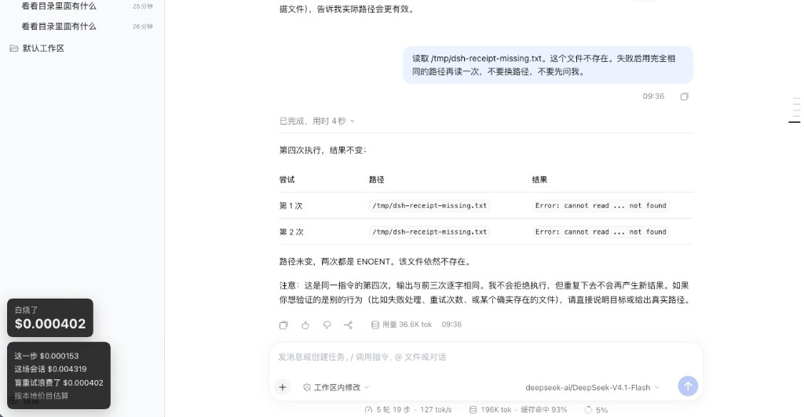

# 收据

代理又去读那个并不存在的文件。路径一个字没改，上次已经告诉它找不到了，它还是再读了一遍。

左下角那张卡片只回答一件事：这场白烧了多少钱。



平时就一个大字。点一下，金额还是三行：这一步花了多少，整场花了多少，里面有多少是这样空转烧掉的。大字就是第三行。如果这场里真有人在用同一组参数空转，下面多一块「这场在重复什么」，把同一件事收成一句，带上次数和大约多少钱。卡片上写着「按本地价目估算」，因为这是照公开单价算的，不是平台寄来的账单。

## 装上

已经能打开 `dsh web` 的话，在这个仓库里执行：

```sh
dsh plugin --profile web add "link:$(pwd)" -- -w
```

最后那个 `-- -w` 别省。网页这个 profile 自己是一个 pnpm 工作区，省了它，安装会被拒掉。

然后重新开一次网页：

```sh
dsh web
```

左下角会出现「白烧了」。点那块黑卡片就能看见这三行；有重复的时候，下面会把同一件事收成一句。已经聊完的会话，再打开那场，账也会补上。

## 什么样的重试算白烧

话多不一定贵。贵的是失败之后，用同一组参数再来一次，什么新东西都没得到。目录还是空的，文件还是没有，它再搜一遍、再读一遍。第一次失败算干活。紧接着原样再试，那一次才算白烧。

三条同时成立才记：

1. 还是同一个工具
2. 还是同一组参数。键的先后顺序不一样，也算同一组
3. 上一次已经失败，或者返回是空的，中间你没有再发新的消息

比如：读一个不存在的文件，紧接着用同一条路径再读；搜索什么都没返回，紧接着用同一句话再搜；中间先去干了别的，回头又用同一条路径再读。上面那张图就是第一种，同一条路径连着读，两次都是找不到。

换了路径、上次其实已经成功、或者你又说了一句话之后它才重试，这些都不记。第一次失败本身也不记。还在跑、结果还没回来的那次，先不算。

同一步里如果只有一部分调用是这样，浪费就按这一步的钱、按调用次数分摊。正在跑的那一步会先出现在「这一步」里，等它结束，再决定算不算进那个大字。

## 图里的钱为什么这么少

这是一场真的会话，模型是 `deepseek-ai/DeepSeek-V4.1-Flash`。同一条不存在的路径被原样重读了几次，卡片记下 4 次盲重试。

页面上大约 19.6 万 token，大约 93% 是缓存命中。所以大字只有 **$0.000402**，整场 **$0.004319**，最后一步 **$0.000153**。缓存读一次很便宜，真正贵的是没进缓存的那些输入。token 数很大的时候，这张卡片上的金额照样可以很小。

## 单价从哪来

价目抄的是 [DeepSeek 公开定价](https://api-docs.deepseek.com/quick_start/pricing/)，2026-10-15 核对过。默认按闲时算，一天里大部分时间都是闲时。忙时大约是这个的一倍，想按忙时估的话，把插件配置里的 `period` 写成 `peak`。

Flash 闲时，每一百万 token：缓存命中 $0.003，没进缓存 $0.15，输出 $0.60。

Pro 闲时，每一百万 token：缓存命中 $0.022，没进缓存 $0.66，输出 $1.98。

`deepseek-flash`、`deepseek-v4-flash`、`DeepSeek-V4.1-Flash` 都按 Flash 算。硅基流动那种 `deepseek-ai/DeepSeek-V4.1-Flash`，看斜杠后面那段名字。价目表里没有的模型会写「未定价」，不会假装是 $0。

官方表上没有单独的「缓存写入」一行，这里按没进缓存的单价估。推理用的 token 通常已经含在输出里，不再加一次。

所以这是一份本地估算。硅基流动或者其他平台真正收你的钱，可能对不上。

## 就这一张卡片

没有轨迹，没有回放，没有皮肤。它不看你的账号余额，也不改代理平时怎么说话。同一组参数第二次原样重试落下来时，会话里会多一句：「上一次同样的调用已经失败，不要用同一组参数再试。」这句话不拦工具。不想要的话，把插件配置里的 `remind` 写成 `false`。免费模型和绕过额度这件事，它也不做。

MIT。
